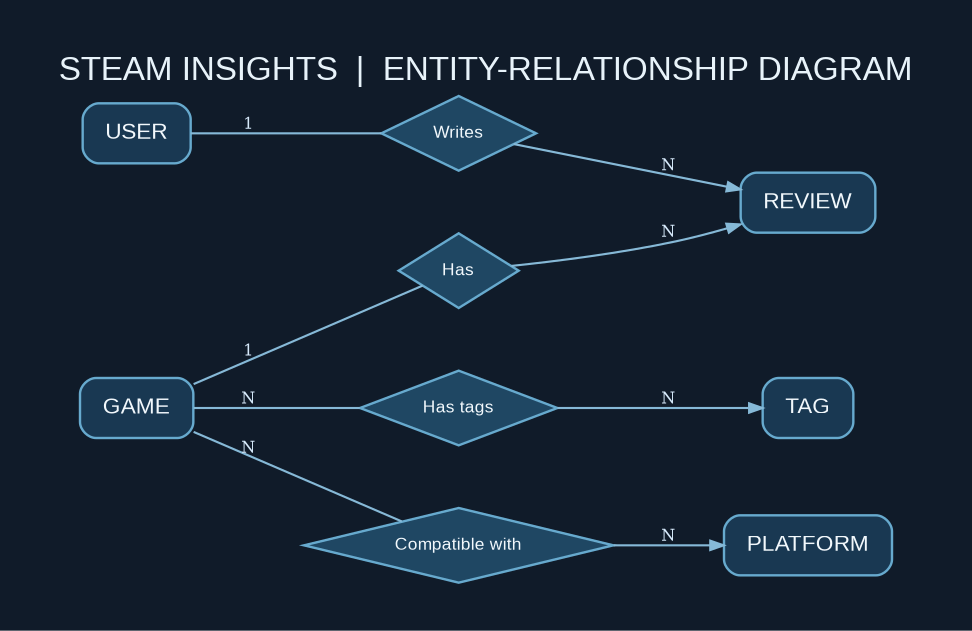
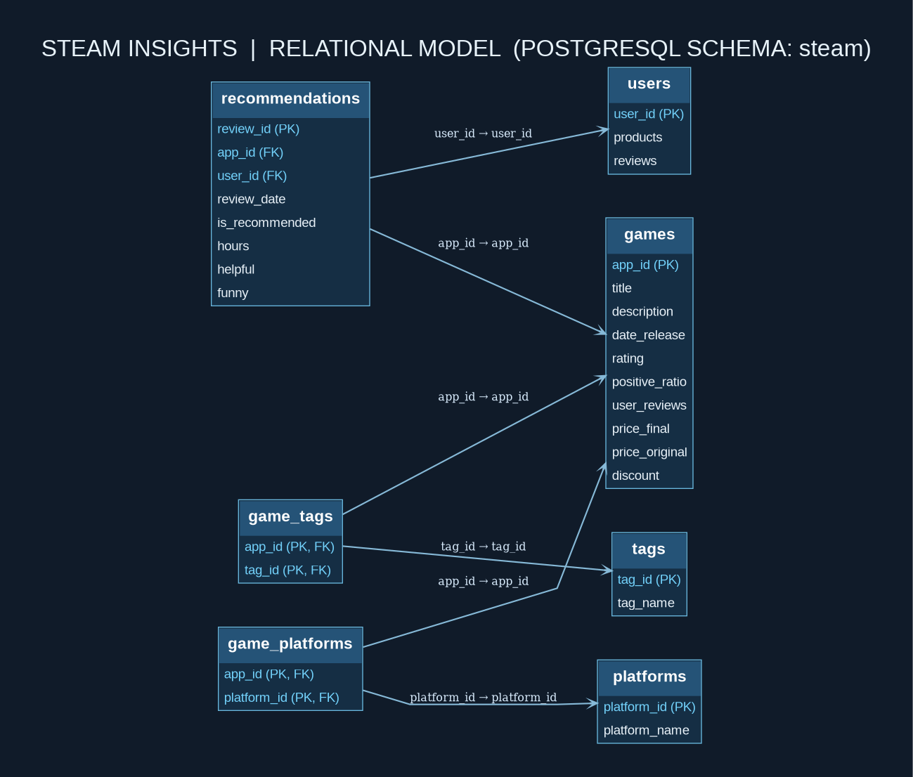

# Steam Insights — Relational Database & Analytics

**Information Technology · Project B · Academic project**

An end-to-end data application built from the public Steam game recommendations dataset. The project downloads raw data, profiles it in PostgreSQL, creates a constrained relational model, runs ten hand-written SQL queries and presents interactive visualizations in a Steam-inspired Streamlit dashboard.

> **Academic disclaimer:** Steam Insights is an independent educational project and is not affiliated with or endorsed by Valve or Steam.

## Project at a glance

| Component | Implementation |
| --- | --- |
| Data source | [Game Recommendations on Steam — antonkozyriev (Kaggle)](https://www.kaggle.com/datasets/antonkozyriev/game-recommendations-on-steam) |
| Database | PostgreSQL (`steam_db`) |
| Database access | Python + `psycopg2` |
| Data ingestion | KaggleHub, CSV `COPY`, JSON metadata loading |
| Data processing | Hand-written PostgreSQL SQL |
| Visualization | Streamlit + Plotly |
| Application | **Steam Insights** |

## Features

- **Reproducible data pipeline:** downloads the dataset, creates the database, loads staging tables, analyzes raw records, builds the relational schema, and inserts data into it.
- **Data profiling in SQL:** row counts, candidate-key uniqueness, missing values, numerical and date ranges, duplicates, and suspicious values.
- **Relational model:** seven normalized application tables with primary keys, foreign keys, checks, and supporting indexes.
- **10 SQL queries:** six standard and four advanced analyses using joins, grouping, CTEs, subqueries, window functions, and a transaction-based `UPDATE` example.
- **Steam-inspired dashboard:** dark navy visual design with three sections: **Data Overview**, **Analytics**, and **SQL Explorer**.
- **Interactive exploration:** at least four visualizations (the dashboard provides six) and SQL-backed filters for release year, rating, platform, price classification, review thresholds, and recommendation periods.
- **Non-destructive transaction demonstration:** the discount simulation displays changed prices but restores the database with `ROLLBACK`.

## Repository structure

```text
proyecto_B/
├── .streamlit/
│   └── config.toml                # Streamlit look and feel
├── data/
│   └── raw/                       # Auto-downloaded; excluded from Git
├── evidence/                      # ER diagram, relational model, other evidence
│   ├── er_diagram.png              # Conceptual ER diagram
│   ├── relational_model.png        # Logical relational model
│   ├── previous_script/           # Archived original implementation
│   └── steam_schema_created.png  # PostgreSQL schema screenshot
├── scripts/
│   ├── db_conn.py                 # Shared PostgreSQL connection
│   ├── download_data.py          # Download the Kaggle dataset
│   ├── create_database.py        # Create steam_db
│   ├── create_staging.py         # Create and load staging tables
│   ├── analyze_data.py           # Raw-data profiling in SQL
│   ├── create_schema.py          # Create physical schema and indexes
│   └── insert_data.py            # Populate relational tables
├── sql/
│   ├── q1_top_20_games_rating.sql
│   ├── q2_platforms_compatible_games.sql
│   ├── q3_top15_tags.sql
│   ├── q4_rating_cat_avgs.sql
│   ├── q5_top10_recommended_games.sql
│   ├── q6_recommendations_avg_playtime.sql
│   ├── q7_top3_rated_per_release_year.sql
│   ├── q8_positive_change_monthly.sql
│   ├── q9_higher_positive_than_avg_cat.sql
│   └── q10_simulating_discounts_top10.sql
├── app.py                        # Streamlit dashboard
├── requirements.txt             # Python dependencies
├── run_data_pipeline_a_d.py     # Data pipeline entry point
├── sql_queries.py               # SQL query runner
├── README.md
├── .gitignore
└── password.txt                  # Local only; never committed
```

`data/raw/` may not exist in a fresh clone: it is created by the download step. The original scripts archived in `evidence/` are for reference, not needed for normal execution.

## Requirements

- **Python 3.10+** (a recent version supported by your chosen dependencies is recommended)
- **PostgreSQL**, running locally on port `5432`
- An accessible [Kaggle](https://www.kaggle.com/) dataset download (internet access for the initial download)
- Python packages: `psycopg2-binary`, `kagglehub`, `streamlit`, and `plotly`

Install all four required Python packages from the committed `requirements.txt`.

## Getting started (Windows / PowerShell)

Run the following commands from the **repository root** (`steam-recommendations-project/`).

### 1. Clone the repository

```powershell
git clone https://github.com/mpenagonzal-18/steam-recommendations-project.git
cd steam-recommendations-project
```

Alternatively, open your existing local copy in VS Code.

### 2. Create a virtual environment and install packages

```powershell
python -m venv .venv
.\.venv\Scripts\Activate.ps1
python -m pip install -r requirements.txt
```

If PowerShell prevents activation, you can still use `.\.venv\Scripts\python.exe` instead of `python` for subsequent commands.

### 3. Configure PostgreSQL credentials

Start PostgreSQL and ensure the connection settings in `scripts/db_conn.py` match your environment:

```python
host='localhost'
port=5432
user='postgres'
dbname=dbname
```

Create a local **`password.txt` in the project root** containing only your PostgreSQL password. For the course assessment, the instructor supplies their own `password.txt`; **do not push yours to GitHub**.

Because the connection module resides under `scripts/`, it must resolve the project root using:

```python
root = Path(__file__).resolve().parent.parent
```

The database name passed by each script must be used as-is (`dbname=dbname`). The database-creation stage connects to the default `postgres` database, while subsequent steps connect to `steam_db`.

### 4. Build and populate the database

**Integration note (pending fixes in the published code at the last review):**

- In `scripts/download_data.py`, use `Path(__file__).resolve().parent.parent / "data" / "raw"` for `target_dir`, so downloads are placed in the repository root rather than under `scripts/`.
- In `scripts/create_database.py`, use `from scripts.db_conn import get_connection, db_name`, consistent with the other modules and the pipeline runner.

The project is documented for reproducibility, but a full clean-clone execution against a local PostgreSQL instance has not yet been independently verified. Apply the two changes above before running the pipeline.

```powershell
python run_data_pipeline_a_d.py
```

The runner executes these stages in sequence:

| Order | Script | Purpose |
| --- | --- | --- |
| 1 | `download_data.py` | Download dataset files into `data/raw/` |
| 2 | `create_database.py` | Create `steam_db` if necessary |
| 3 | `create_staging.py` | Create staging tables and import CSV data |
| 4 | `analyze_data.py` | Profile raw values using SQL |
| 5 | `create_schema.py` | Create the `steam` relational model |
| 6 | `insert_data.py` | Insert processed records and relationships |

**Initial loading can take time**, particularly for the recommendations table. The relational load is designed to run transactionally, so an insertion failure rolls back that load rather than leaving it partially populated. The pipeline is intended for initial setup; do not assume every stage can be rerun into populated tables without resetting them.

### 5. Run the SQL query suite

```powershell
python sql_queries.py
```

The Python runner reads queries from `sql/` and executes them using the shared PostgreSQL connection. Both the query runner and the dashboard reference the existing file `q9_higher_positive_than_avg_cat.sql`. The Q10 `RETURNING` output may not be displayed by this multi-statement runner because `ROLLBACK` is the final statement; the dashboard uses a dedicated simulation function that retrieves those rows before rollback. You can also inspect each file individually in pgAdmin. If you rename any SQL file, update the corresponding references in `sql_queries.py` and `app.py`.

### 6. Launch the dashboard

```powershell
python -m streamlit run app.py
```

Open the local URL displayed by Streamlit (typically **http://localhost:8501**). PostgreSQL must remain running while using the application.

## Database design

The database was designed at two levels: a conceptual **entity–relationship (ER) model** and a logical **relational model**. The resulting tables are implemented under PostgreSQL's `steam` schema; raw imported data is stored separately under `staging`.

### Entity–relationship diagram

The conceptual model contains five entities: **USER**, **GAME**, **REVIEW**, **TAG**, and **PLATFORM**. A user writes reviews, a game receives reviews, and games have many-to-many relationships with tags and compatible platforms. In the physical implementation, **REVIEW** is named `steam.recommendations`.



### Relational model

The logical design maps those relationships into seven tables. The two many-to-many relationships use associative tables (`game_tags` and `game_platforms`), while each recommendation references one game and one user.



| Table | Role |
| --- | --- |
| `steam.games` | Game identifiers, names, release dates, ratings, review counts, and prices |
| `steam.users` | Steam user identifiers and aggregate account activity |
| `steam.recommendations` | User-to-game reviews, dates, recommendation flags, playtime, and helpful/funny votes |
| `steam.tags` | Distinct tag names |
| `steam.game_tags` | Many-to-many bridge between games and tags |
| `steam.platforms` | Platform lookup table |
| `steam.game_platforms` | Many-to-many bridge between games and supported platforms |

The `staging` schema includes the three raw CSV tables and `metadata_raw` for JSON-derived game descriptions and tags. `scripts/create_schema.py` creates primary keys, foreign keys, domain `CHECK` constraints, and supporting indexes. The diagrams above illustrate the core design; the SQL DDL is the authoritative specification of all columns and constraints.

## SQL query catalogue

| # | Question / analysis | Level |
| --- | --- | --- |
| 1 | Which games rank highest by positive rating? | Standard |
| 2 | How many games support each platform? | Standard |
| 3 | Which tags appear most often? | Standard |
| 4 | How do average price and rating vary across rating categories? | Standard |
| 5 | Which games receive the most positive recommendations? | Standard |
| 6 | How does playtime differ between positive and negative recommendations? | Standard |
| 7 | Which three highly rated games lead each release year? | Advanced — CTE + window ranking |
| 8 | How does the positive recommendation rate change month to month? | Advanced — monthly aggregation + `LAG()` |
| 9 | Which games exceed the average positive rating of their rating category? | Advanced — category comparison / subquery or optimized CTE |
| 10 | What would a 10% promotional discount do to selected game prices? | Advanced — `BEGIN` / `UPDATE` / `RETURNING` / `ROLLBACK` |

**Important:** Q9 currently uses correlated subqueries and can be expensive. The dashboard offers a CTE-based optimized mode; an optimized CTE version can also replace the source SQL to improve the standalone query runner. Q10 is a temporary update demonstration, not a permanent price change.

The course report should document **each query's question, SQL source, sample output, interpretation, and author**. Example values must be obtained by running SQL on the actual database, not fabricated.

## Streamlit dashboard

### Data Overview

Explore the seven relational tables using estimated row counts, table-level metrics, selected row samples, and column definitions. More expensive exact summaries are requested explicitly to avoid repeatedly scanning large tables.

### Analytics

Six SQL-powered visualizations cover rating distributions, platform coverage, tag popularity, highly rated games, monthly recommendation trends, and average playtime by recommendation type. Controls support filtering by release-year range, rating category, platform, free/paid status, minimum reviews, and selected review periods where applicable.

**All filtering, joining, grouping, and calculations are done in PostgreSQL.** Python passes parameters, retrieves result rows, and renders charts. Filter values are parameterized rather than concatenated into user-editable SQL.

### SQL Explorer

Browse the ten SQL scripts, execute them individually, inspect returned rows, and export results as CSV. The discount simulation always rolls back. The app uses caching and on-demand execution for heavier queries; speed depends on dataset size and local PostgreSQL resources.

## Verification and troubleshooting

Use pgAdmin or a SQL client connected to `steam_db` to verify the schema:

```sql
SELECT current_database();

SELECT table_schema, table_name
FROM information_schema.tables
WHERE table_schema IN ('steam', 'staging')
ORDER BY table_schema, table_name;
```

Common issues:

- **`relation "steam.games" does not exist`** — ensure the query tool is connected to `steam_db` (not `postgres`) and that the schema-creation/load stages completed.
- **`password.txt` not found** — place it in the repository root and check `root = Path(__file__).resolve().parent.parent` in `scripts/db_conn.py`.
- **Missing Python package** — activate the intended virtual environment and run `python -m pip install -r requirements.txt`.
- **Large queries are slow** — use the optimized Q9, apply appropriate filters, and consider `ANALYZE steam.recommendations;` after initial loading; do not remove indexes defined by the schema.
- **SQL file missing in the dashboard** — check that its name in `sql/` matches the corresponding entry in `app.py`.

## Data governance and Git hygiene

The Git repository contains **source code and documentation**, not downloaded raw data or local credentials. At minimum, `.gitignore` should contain:

```gitignore
password.txt
.env
.env.*
!.env.example
.streamlit/secrets.toml
data/raw/
__pycache__/
*.py[cod]
.venv/
venv/
.vscode/
.pytest_cache/
.DS_Store
Thumbs.db
```

Keep **`.streamlit/config.toml` tracked** because it defines the dashboard theme. The `data/raw/` directory is created by the download stage once its path is corrected, and should not be committed. Do not commit `password.txt` even if the project is private.

## Current verification status

The repository structure, SQL files, dashboard source, and diagram links have been reviewed. A full fresh-clone data load and Streamlit run against a local PostgreSQL instance have **not** been verified. The Q9 filename references and dependency file are already correct. Apply the two pending integration fixes documented above, then run the complete pipeline, SQL runner, and app locally before submitting.

## Course deliverables

In addition to this repository, the assignment requests a report and presentation. The report should include the data source and license, data profiling and cleaning rules, ER/relational models, physical schema and constraints, ten documented SQL queries with credited authors, dashboard screenshots, and an AI-adoption record (including how AI-generated work was checked). The team must also provide an effort log. Refer to the official project brief for the final grading and submission requirements.

## Credits

- **Dataset:** [Game Recommendations on Steam](https://www.kaggle.com/datasets/antonkozyriev/game-recommendations-on-steam), published on Kaggle by antonkozyriev. Check the dataset page for the applicable license and attribution before publication.
- **Project:** Information Technology, Project B.
- **Team members and query authors:** add the actual names and contributions before submission.

---

*This repository is an academic implementation. The app's charts and metrics depend on the dataset downloaded and the PostgreSQL data loaded locally; no live Steam API connection is implied.*
